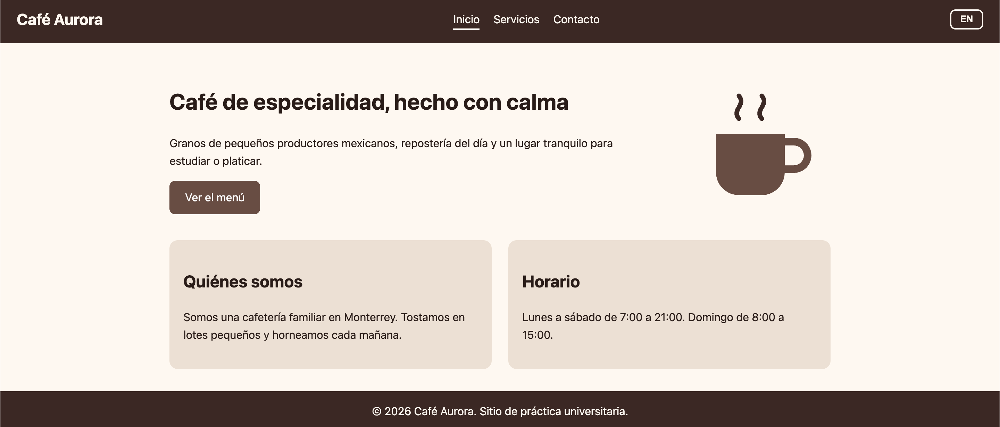
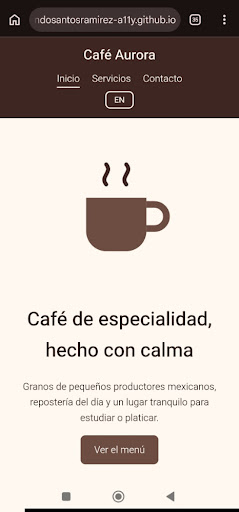
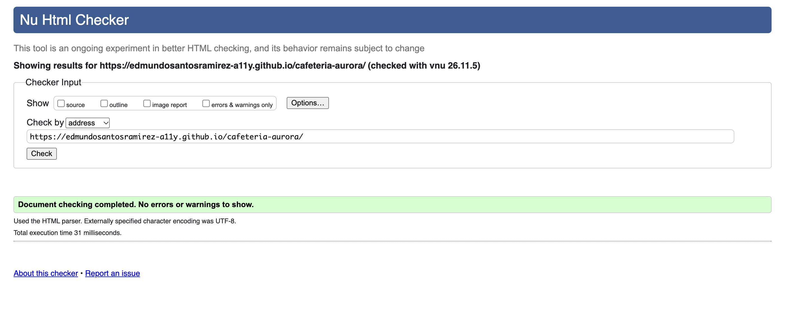
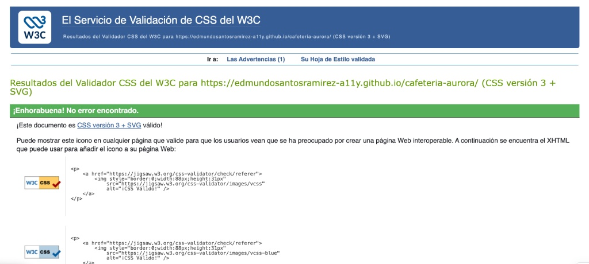

# Café Aurora

**Español** | [English](#english)

Sitio web responsivo, semántico y accesible para una cafetería ficticia, con versión en español e inglés. Actividad 2 del Laboratorio de Programación Web.

Autor: Edmundo Santos Ramírez, matrícula 2148132.

## Objetivo
Construir y publicar un sitio con HTML5 semántico y CSS moderno, aplicando usabilidad, accesibilidad y validación de estándares.

## Tecnologías
HTML5, CSS3 (Flexbox y Grid), JavaScript básico para el cambio de idioma, Git/GitHub y GitHub Pages.

## Estructura
Tres vistas: Inicio, Servicios y Contacto. Un breakpoint en 768 px para celular.

## Accesibilidad
Textos alternativos, labels en el formulario, jerarquía de encabezados, enlace para saltar al contenido, foco visible, contraste legible y atributo `lang` que cambia con el idioma.

## Capturas
### Escritorio

### Móvil

## Resultados de validación
### Validación HTML (W3C Validator)

### Validación CSS (W3C Jigsaw)

## Sitio publicado
https://edmundosantosramirez-a11y.github.io/cafeteria-aurora/

---

# Café Aurora (English)

Responsive, semantic and accessible website for a fictional café, available in Spanish and English. Activity 2 of the Web Programming Lab.

Author: Edmundo Santos Ramírez, student ID 2148132.

## Goal
Build and publish a site using semantic HTML5 and modern CSS, applying usability, accessibility and standards validation.

## Technologies
HTML5, CSS3 (Flexbox and Grid), basic JavaScript for the language switch, Git/GitHub and GitHub Pages.

## Structure
Three views: Home, Services and Contact. One breakpoint at 768 px for mobile.

## Accessibility
Alternative text, form labels, heading hierarchy, skip link, visible focus, readable contrast and a `lang` attribute that changes with the language.

## Screenshots
### Desktop

### Mobile

## Validation results
### HTML Validation (W3C Validator)

### CSS Validation (W3C Jigsaw)

## Live site
https://edmundosantosramirez-a11y.github.io/cafeteria-aurora/
